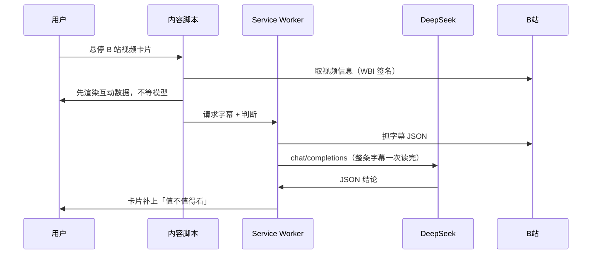

# Bili-Insight

<div align="center">
    
</div>

Bili Insight 是一个 [Chrome 插件](https://chrome.google.com/webstore/detail/bili-insight%EF%BC%8C%E6%B4%9E%E5%AF%9Fb%E7%AB%99%E8%A7%86%E9%A2%91%E5%86%85%E5%AE%B9%E6%8F%92%E4%BB%B6/akodljjoaekbfjacabnihcbcbioidnfg?hl=zh-CN)：把鼠标悬停在 B 站任意视频卡片上，直接告诉你**这视频值不值得看**。不用点进去，不用拖进度条。

<p align="center">
     📺 <a href="https://b23.tv/P9ao5bc" target="_blank">介绍视频1</a>
     📺 <a href="https://www.bilibili.com/video/BV1KV4y1S7Rw/" target="_blank">介绍视频2</a>
     📑 <a href="https://emoumcwvfx.feishu.cn/docx/FUNYdH8ClolsBjxrEm3crZt0nTh" target="_blank">项目规划文档</a>
</p>

## 卡片里有什么

悬停后弹出的卡片，从上到下：

* **一句结论 + 0-100 分**，三档：值得看 / 扫一眼 / 跳过
* **2-4 条真正的信息点**，每条前面带时间戳（如 `12:30`），**点一下直接跳到视频对应进度**
* **四个辅助判断**：密度、适合谁看、同质化风险、时间成本
* 点赞、投币、收藏、分享、投稿时间、时长、分区标签
* 可选的词云与思维导图（词云默认关闭）
* 视频没有字幕时，卡片会明确标注「无字幕 · 仅依据标题与简介推断」

时间戳是这一版的重点：字幕每行会带上 `[mm:ss]` 一起交给模型，模型只在字幕里真的出现过的位置给出秒数，服务端再把超出时长的值夹回区间。如果当前就在这个视频的播放页，点时间戳是直接 seek 播放器；在列表页悬停则新标签打开 `?t=` 链接。

字幕来源也补全了：先看 `/x/web-interface/view`，不够再查 `/x/player/wbi/v2`（按 cid 取，分 P 跟当前 P）。候选按**人工中文 CC > AI 中文 > 其它语言**排序，AI 字幕会在卡片上标「AI 字幕 · 识别可能有错字」。超长字幕改成首 70% + 尾 30% 采样，长视频的结论段不会再被砍掉。

## 安装

1. 打开 `chrome://extensions/`，开启右上角「开发者模式」，点「加载已解压的扩展程序」，选择本仓库的 `chrome-extension` 目录
2. 点扩展图标，填三样东西：

| 项 | 值 |
| --- | --- |
| API Key | 你的 DeepSeek Key，在 [platform.deepseek.com](https://platform.deepseek.com) 申请 |
| 接口地址 | `https://api.deepseek.com` |
| 模型 | `deepseek-flash` |

3. 点「测试连接」，看到「连接正常」就可以去 B 站了

接口地址填任何 **OpenAI 兼容**网关都行（自建转发、其他厂商的兼容端点都可以），这就是 issue #6 / #7 / #9 想要的自定义 API Host。Key 只存在浏览器本地 `chrome.storage.sync`，不经过任何第三方服务器。

## 成本

默认 `deepseek-flash`：1M 上下文，$0.15 / $0.60 每百万 token（输入 / 输出）。一条 20 分钟视频的字幕约 8k token，一次判断不到一分钱。悬停场景会显式关闭思考模式（`thinking: disabled`），否则默认 `effort=high` 的推理会让卡片等很久。

## 设计



### 为什么 refine 链没了

早期版本用 `gpt-3.5-turbo-16k`，上下文装不下长字幕，只能分块 + 逐块精炼（见 `img/refine_chain.png`），代价是延迟随视频长度线性增长。`deepseek-flash` 是 1M 上下文，一条视频的字幕一次就能读完，分块只会增加延迟和调用次数，所以整条 langchain refine 链连同 langchain 依赖一起删掉了。

## 自建服务（可选）

插件默认直连模型厂商，不需要后端。如果你不想把 Key 分发到每台机器的浏览器，或者要统一计费，可以起 `api.py`：

```bash
pip install -r requirements.txt
DEEPSEEK_API_KEY=sk-xxx RELAY_TOKEN=your-token uvicorn api:app --port 8000
```

然后把插件的「接口地址」填 `http://127.0.0.1:8000`，「API Key」填 `RELAY_TOKEN` 的值。

| 端点 | 用途 |
| --- | --- |
| `/chat/completions` | 转发端点，服务端持 Key，客户端只带 `RELAY_TOKEN` |
| `/summary` | 直接返回结构化判断，方便 curl 调试 |
| `/outline` | 直接返回 markmap 用的 Markdown 大纲 |
| `/run/predict` | 兼容旧版插件的 Gradio 风格接口 |
| `/health` | 健康检查 |

没有设置 `RELAY_TOKEN` 时转发端点返回 503，避免变成公开的免费代理。

## 测试

所有用例**都不访问外网**：模型请求打到测试进程里起的假上游（随机端口，仅本机可见），B 站接口和 DOM 全部用桩替代。

```bash
# 后端 + manifest 校验
pip install -r requirements-dev.txt
python -m pytest

# 扩展脚本（Node 22+，不需要 npm install）
node --test tests/js/*.js
```

| 文件 | 守的是什么 |
| --- | --- |
| `tests/test_llm.py` | 提示词拼装、模型输出的脏数据收敛（分数越界 / points 非数组 / JSON 带围栏 / 缺一级标题）、要点时间戳的解析与夹取、超长字幕首尾采样、单次调用、错误路径 |
| `tests/test_api.py` | 六个端点、relay 鉴权 401/503、坏请求 400、上游失败 502 |
| `tests/test_manifest.py` | `host_permissions` 是否覆盖全部网络调用、声明的文件是否都存在且非空、两份 manifest 有没有漂移 |
| `tests/js/test_bg_page.js` | 一次悬停只花一次调用、缓存命中/过期/版本失效、429 与 `Retry-After`、5xx 上限、滑走取消、字幕响应形状、`points` 的 `at` 归一化 |
| `tests/js/test_biliapi.js` | 请求编排：一次悬停一条请求、同视频去重、A→B 时 abort、getVideo 失败后能重试；字幕来源择优（人工 CC > AI > 其它）、分 P 取 cid、player 接口失败回退、弹幕转字幕要忽略 |
| `tests/js/test_content_dom.js` | 五个脚本按 manifest 顺序能加载、bvid 提取的各种边界、时长与时间戳显示、要点 HTML 转义、点时间戳时 seek 播放器 / 新标签打开 |

`test_manifest.py` 看起来最不起眼，但它对应真实事故：MV3 里没声明 `host_permissions`，service worker 的 `fetch` 会被直接拦掉，而页面上毫无反应——插件「突然什么都不做」，却没有任何报错。

CI（`.github/workflows/ci.yml`）在 Node 22/24、Python 3.10/3.12 上各跑一遍，外加一个只做静态校验的 manifest job。

**测不到的部分**：真实 B 站页面的悬停、真实 Key 的线上请求。这两件事仍需手动验：悬停一个有字幕的视频，确认卡片出结论且 `chrome.storage.local` 里出现 `bi:c:BVxxx:*`；刷新后再悬停同一视频，Network 里不该有新的 `chat/completions`。

## 加入我们

<b>1. 添加个人联系方式</b>
<div align="center">
    
    <br/><br/><br/><br/><br/>
</div>

<b>2. 加入开发/体验/内测组</b>
<div align="center">
    
</div>

## 参考资料
* [吕立青：BiliGPT](https://github.com/JimmyLv/BibiGPT)
* [插件：让你瞬间了解B站UP主](https://github.com/gaogaotiantian/biliscope)
* [Bilibili-Evolved](https://github.com/the1812/Bilibili-Evolved)

## LICENSE
<a rel="license" href="http://creativecommons.org/licenses/by-nc-sa/4.0/"></a><br />本作品采用<a rel="license" href="http://creativecommons.org/licenses/by-nc-sa/4.0/">知识共享署名-非商业性使用-相同方式共享 4.0 国际许可协议</a>进行许可。
